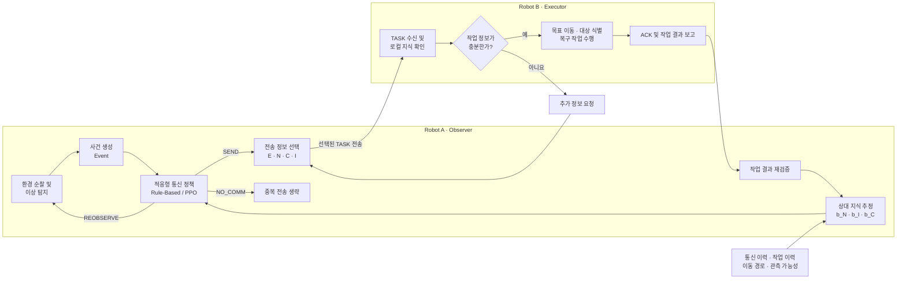

# KARCo
### Knowledge-Aware Adaptive Communication for Multi-Robot Collaboration

**KARCo**는 멀티로봇 협업 환경에서 상대 로봇의 지식 상태를 추정하고, 작업 수행에 필요한 정보만 선택적으로 전달하여 통신 효율을 높이는 프로젝트입니다.

기존의 전체 정보 공유(Full Sharing) 방식과 달리, 로봇 간 통신 이력, 작업 수행 이력, 이동 경로 및 관측 가능성을 활용해 상대 로봇이 이미 알고 있을 정보를 추정합니다.

이를 바탕으로 **규칙 기반(Rule-Based) 및 강화학습(PPO) 기반 적응형 통신 정책**을 구현하고, 통신량과 작업 수행 성능을 비교·평가하는 것을 목표로 합니다.

---

## 1. 프로젝트 개요

멀티로봇 협업 시스템에서는 로봇들이 서로의 상태와 작업 정보를 공유하며 공동 작업을 수행합니다.

그러나 모든 정보를 지속적으로 공유하면 불필요한 통신 비용이 발생하고, 반대로 정보를 지나치게 줄이면 상대 로봇이 작업에 필요한 정보를 확보하지 못해 작업 실패나 추가 통신이 발생할 수 있습니다.

KARCo는 이러한 문제를 해결하기 위해 **상대 지식 추정(Receiver Knowledge Estimation) 기반 적응형 통신 시스템**을 제안합니다.

### 로봇별 역할

| 구분 | 역할 |
|---|---|
| **Robot A (Observer)** | 환경 순찰, 이상 상황 탐지, 상대 지식 추정, 전송 정보 선택 |
| **Robot B (Executor)** | 목표 위치 이동, 이상 대상 확인 및 복구, 필요시 추가 정보 요청 |

### 핵심 목표

- 상대 로봇의 지식 상태를 확률적으로 추정
- 작업에 필요한 정보만 선택적으로 전달
- 중복되거나 불필요한 이미지·상태 정보 전송 최소화
- 상대 지식 추정 오류 발생 시 추가 통신을 통한 복구
- 규칙 기반 및 PPO 기반 통신 정책의 성능 비교
- 실제 멀티로봇 환경에서 통신 효율성과 작업 성공률 검증

---

## 2. 전체 시스템 구조



전체 흐름은 다음과 같습니다.

1. Robot A가 이상 상황을 감지해 사건 정보를 생성합니다.
2. 통신·작업 이력과 이동 경로를 바탕으로 Robot B의 지식 상태를 확률적으로 추정합니다.
3. 규칙 기반 또는 PPO 정책이 사건 정보와 지식 추정값을 입력받아 전송할 정보 조합을 결정합니다.
4. Robot B는 수신한 정보가 충분하면 복구를 수행하고, 부족하면 필요한 정보만 추가로 요청합니다.
5. 작업 결과는 Robot A의 재검증과 다음 지식 추정에 다시 반영됩니다.

---

## 3. 핵심 기술

### 3.1 상대 지식 추정 (Receiver Knowledge Estimation)

Robot A는 Robot B가 현재 어떤 정보를 알고 있을지 확률적으로 추정합니다.

이를 위해 다음 정보를 활용합니다.

- **통신 이력:** 이전에 전송한 정보 및 ACK 수신 기록
- **작업 이력:** B가 이전 작업에서 직접 관측하거나 활용한 정보
- **이동 이력:** B가 이동한 경로와 작업대 통과 여부
- **관측 가능성:** 이동 중 물체를 관측하고 저장했을 가능성
- **정보 유효성:** 물체 위치 변경, 기억 초기화 등으로 인한 정보의 유효성 변화

예시:

```python
belief = {
    "b_N": 0.9,   # B가 정상 위치를 알고 있을 확률
    "b_I": 0.72,  # B가 물체 외형을 알고 있을 확률
    "b_C": 0.0    # B가 현재 위치를 알고 있을 확률
}
```

특히 직접 전달한 정보뿐 아니라, **B가 이동 중 관측을 통해 간접적으로 획득했을 가능성이 있는 지식**까지 고려합니다.

### 3.2 적응형 정보 선택 (Adaptive Information Selection)

로봇 간 공유하는 정보를 다음 네 가지 항목으로 구분합니다.

| 정보 | 기호 | 내용 |
|---|---|---|
| 사건 정보 | E | 사건 ID, 발생 위치, 대상 ID, 이상 종류, 복구 요청 |
| 정상 상태 | N | 물체의 정상 위치 및 방향 |
| 현재 상태 | C | 물체의 현재 위치 및 위치 추정 오차 |
| 시각 정보 | I | 물체 식별을 위한 RGB Crop 이미지 |

모든 정보를 전송하는 대신, 상대 로봇의 지식 상태와 현재 작업 상황을 고려하여 필요한 항목만 선택합니다.

예를 들어 B가 물체의 정상 위치와 외형을 이미 알고 있다면 해당 정보를 생략하고 사건 정보만 전달할 수 있습니다.

반대로 유사한 물체가 존재하여 식별이 어렵다면 현재 위치나 이미지를 추가로 전송할 수 있습니다.

### 3.3 규칙 기반 통신 선택 (Rule-Based Communication)

상대 지식 추정값과 현재 작업 상황을 입력받아 전송할 정보 조합을 선택합니다.

주요 과정은 다음과 같습니다.

1. 현재 사건 및 작업 요구사항 분석
2. B의 지식 추정값 확인
3. 전송 가능한 메시지 조합 생성
4. 후보별 통신 비용 및 작업 실패 위험 계산
5. 최소 기대비용을 갖는 메시지 선택

통신 비용뿐 아니라 추가 정보 요청, 잘못된 대상 조작, 재관측 및 작업 미해결 비용을 함께 고려합니다.

### 3.4 강화학습 기반 통신 선택 (PPO)

PPO(Proximal Policy Optimization)를 활용하여 통신 정책을 학습합니다.

규칙 기반 정책과 동일한 환경에서 상대 지식 추정값과 작업 상태를 입력받고, 통신 비용과 작업 수행 결과를 고려하여 전송 정보를 선택하도록 설계합니다.

두 정책을 비교하여 적응형 통신 전략의 효율성을 평가할 예정입니다.

---

## 4. 실험 시나리오

### 시나리오 ① 첫 사건 발생 및 기본 통신

**상황**

Robot A가 순찰 중 작업대 S1에서 물체 P의 위치 이상을 발견합니다. Robot B는 해당 물체의 정상 위치와 외형을 모르는 초기 상태입니다.

**구현 방법**

1. A가 정상 상태와 현재 상태를 비교하여 이상을 탐지하고 사건 ID를 생성합니다.
2. B의 초기 지식 상태를 바탕으로 필요한 정보를 판단합니다.
3. 사건 정보(E)와 정상 위치(N)를 선택하여 전송합니다.
4. B는 ACK를 보내고 해당 위치로 이동해 복구 작업을 수행합니다.
5. A가 작업 결과를 재검증하고 B의 지식 추정값을 갱신합니다.

동일 사건의 중복 전송과 ACK 유실에 따른 재전송 상황도 함께 검증합니다.

**검증 목표:** 처음 수행하는 작업에서 최소한의 정보로 정확한 복구가 가능한지 확인합니다.

### 시나리오 ② 기존 지식 재사용

**상황**

이전에 복구했던 물체 P가 다시 정상 위치에서 벗어납니다. A는 과거 작업 이력을 바탕으로 B가 정상 위치와 외형을 알고 있을 가능성이 높다고 추정합니다.

**구현 방법**

1. A가 새로운 이상을 발견하고 기존 통신 및 작업 이력을 확인합니다.
2. B의 정상 위치 지식과 외형 지식 추정값을 활용합니다.
3. 기존 지식이 충분한 경우 사건 정보(E)만 전송합니다.
4. 유사 물체가 등장하여 위치 정보가 필요하면 현재 위치(C)를 추가합니다.
5. B의 기억 초기화나 잘못된 기억으로 문제가 발생하면 추가 정보 요청 및 재검증으로 대응합니다.

**검증 목표:** 과거 작업에서 획득한 지식을 재사용하여 불필요한 통신을 줄일 수 있는지 확인합니다.

### 시나리오 ③ 이동 중 관측한 지식 활용

**상황**

B가 다른 작업을 위해 이동하면서 작업대 S2를 지나갑니다. A는 B가 S2의 물체 Q를 관측했을 가능성을 추정합니다.

이후 S2에서 물체 Q의 이상이 발생합니다.

**구현 방법**

1. B의 이동 경로와 작업대 위치를 바탕으로 관측 가능성을 계산합니다.
2. 관측 확률을 이용해 B의 정상 상태 및 외형 지식 추정값을 갱신합니다.
3. A가 이상을 발견하면 메시지 조합별 기대비용을 계산합니다.
4. B가 외형을 알고 있을 가능성이 충분하다면 이미지를 생략하고 E + N + C를 전송합니다.
5. 실제로 관측하지 못한 경우 B가 현장에서 추가 정보를 요청합니다.
6. A가 필요한 정보를 보충하고 복구 결과를 재검증합니다.

시야 확보 및 가림 조건을 구분하여 실험합니다.

**검증 목표:** 직접 통신하지 않고 이동 중 획득했을 것으로 추정한 지식을 활용하여 통신량을 줄일 수 있는지 확인합니다.

### 시나리오 ④ 유사 물체 식별 및 오조작 대응

**상황**

작업대 S1에 외형이 비슷한 물체 P와 P′이 존재합니다. 두 물체가 가까이 있어 위치 정보만으로 정확한 식별이 어려운 상황입니다.

**구현 방법**

1. A가 유사 물체 존재 여부, 물체 간 거리 및 위치 추정 오차를 확인합니다.
2. B의 외형 지식과 위치 오차를 고려하여 메시지별 기대비용을 계산합니다.
3. 식별 정보가 부족한 경우 E + N + C + I를 전송합니다.
4. B가 잘못된 물체를 복구하면 A가 재검증을 통해 오류를 발견하고 재작업을 요청합니다.
5. B의 이동 중 물체 위치가 변경되면 POSE_UPDATE로 최신 위치를 전달합니다.
6. A도 대상을 확실히 식별하지 못하는 경우에는 재관측 후 통신을 진행합니다.

**검증 목표:** 식별 불확실성이 존재하는 상황에서도 통신 효율성과 복구 신뢰성을 유지할 수 있는지 확인합니다.

---

## 5. 비교 실험

제안하는 적응형 통신 정책의 효과를 검증하기 위해 다음 방식들을 비교할 계획입니다.

| 방식 | 설명 |
|---|---|
| Full Sharing | 이상 발생 시 모든 정보를 전송 |
| Confirmed Cache | 기존 통신에서 수신이 확인된 정보를 재사용 |
| Minimal Push + Pull | 최소 정보만 먼저 전송하고 부족하면 추가 요청 |
| Rule-Based Adaptive | 상대 지식과 기대비용을 기반으로 전송 항목 선택 |
| PPO Adaptive | 강화학습을 통해 전송 항목 선택 정책 학습 |

### 평가 지표

| 평가 지표 | 설명 |
|---|---|
| Task Success Rate | 작업 성공률 |
| Communication Cost | 전체 전송 데이터량(Byte) 및 통신 횟수 |
| Task Completion Time | 이상 발견부터 작업 완료까지 걸린 시간 |
| Information Request Rate | 추가 정보 요청 발생 비율 |
| Incorrect Action Rate | 잘못된 대상 조작 발생 비율 |
| Communication Efficiency | 작업 성능 대비 통신 효율 |

동일한 실험 환경에서 각 통신 정책을 비교하여 통신 비용과 작업 수행 성능 사이의 관계를 분석할 예정입니다.

---

## 6. 프로젝트 구조

아래는 개발을 위한 예정 디렉터리 구조이며, 실제 구현 과정에서 변경될 수 있습니다.

```text
KARCo/
│
├── README.md
│
├── knowledge_estimation/
│   └── 상대 지식 추정 모듈
│
├── communication/
│   ├── rule_based/
│   │   └── 규칙 기반 통신 선택
│   │
│   └── ppo/
│       └── PPO 기반 통신 선택
│
├── robot_a/
│   └── 순찰 및 이상 탐지
│
├── robot_b/
│   └── 이동 및 작업 수행
│
├── simulation/
│   └── 시나리오 및 실험 환경
│
└── evaluation/
    └── 성능 평가
```

---

## 7. 개발 현황

**현재 상태: 개발 진행 중 (In Development)**

| 구성 요소 | 진행 상태 |
|---|---|
| 전체 시스템 및 시나리오 설계 | 설계 진행 중 |
| 상대 지식 추정 모듈 | 구현 예정 |
| 규칙 기반 최소 통신 선택 | 구현 예정 |
| PPO 기반 통신 선택 | 구현 예정 |
| 멀티로봇 시스템 통합 | 구현 예정 |
| 비교 실험 및 성능 평가 | 실험 예정 |

※ 개발 현황은 프로젝트 진행에 따라 업데이트됩니다.

---

## 8. 연구 목표 및 기대효과

KARCo는 멀티로봇 협업 환경에서 상대 로봇의 지식을 추정하고, 이를 기반으로 불필요한 정보 전송을 줄이는 적응형 통신 시스템 구현을 목표로 합니다.

특히 기존에 명시적으로 전달한 정보뿐 아니라 **이동 경로와 관측 가능성을 통해 상대 로봇이 간접적으로 획득했을 지식까지 고려**한다는 점에 초점을 맞춥니다.

이를 통해 다음과 같은 효과를 검증하고자 합니다.

- 상대 지식 추정 기반 불필요한 정보 전송 감소
- 이미지 등 대용량 데이터의 선택적 전송
- 지식 추정 오류 발생 시 추가 통신을 통한 안정적인 작업 수행
- 규칙 기반 및 강화학습 기반 통신 정책의 성능 비교
- 실제 멀티로봇 협업 환경에서의 적용 가능성 확인

궁극적으로 **통신 효율성과 작업 수행 신뢰성을 함께 고려하는 지식 기반 멀티로봇 협업 통신 프레임워크**를 구현하고자 합니다.
